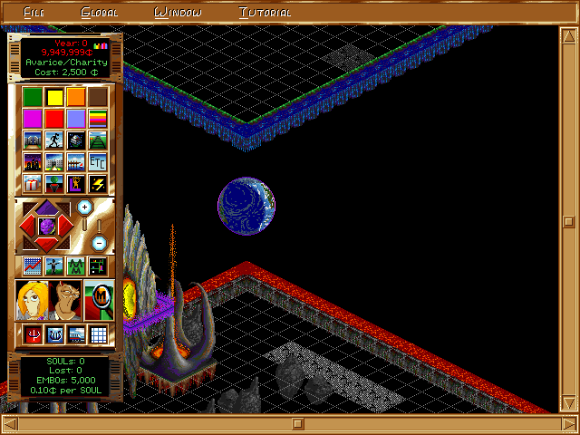
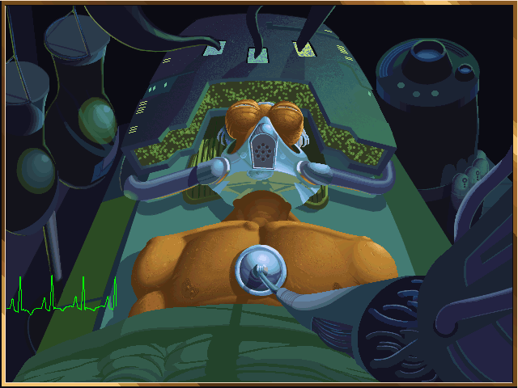
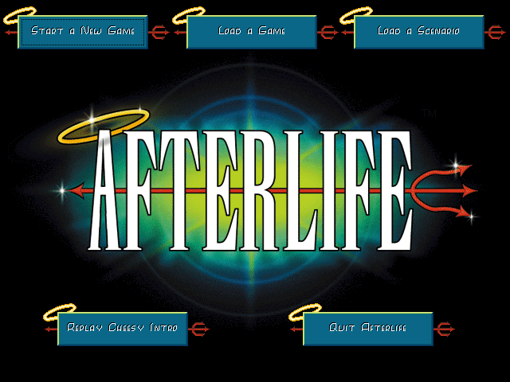
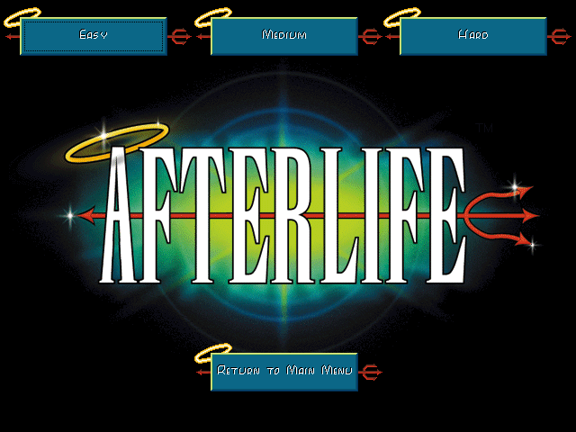
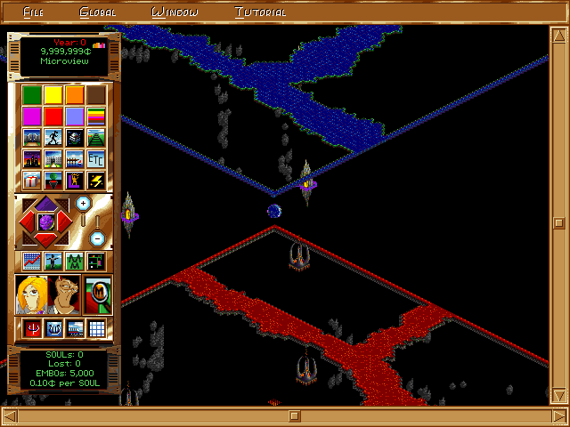

# Afterlife — Static Recompilation

Static recompilation of **Afterlife** (LucasArts, 1996), the Heaven-and-Hell
city builder, from the Windows 95 executable on its CD (`ALIFE.EXE`, 30 May
1996) to native C. No emulator and no wrapper DLLs: the game's own code,
recompiled, calling Windows directly. The CD also carries an MS-DOS build
(`ALIFEDOS.EXE`); this project uses the Windows one.

Built on the [pcrecomp](https://github.com/sp00nznet/pcrecomp) toolchain, on
its `main` branch, and following
its house style: layout, command line, headless mode.

## Getting Started

You need **your own Afterlife CD** (the US release, with `ALIFE.EXE` and
`ALIFE.000` in its root), in a drive or copied to a folder. Nothing from the
game is in this repository or downloaded for you; everything is built on your
machine from your copy. The game is not installed: it reads everything from
the CD's files, as the CD's "no installation" option did.

### The setup scripts

1. Download this repository (the green **Code** button, then **Download
   ZIP**) and unzip it somewhere with 2 GB free.
2. Windows: double-click **`Setup.cmd`**. Linux and macOS are not supported
   yet; `./setup.sh` says so and stops.
3. Play with **`Afterlife`** in that folder.

The script checks for Python 3.10+, `pefile` and `capstone`, the pcrecomp
toolkit (cloned beside this folder from `main` if it is
missing) and the Visual Studio 2022 C++ compiler, and asks before installing
any of them. It looks for the CD on every drive, or asks
(`Setup.cmd -GameDir E:\` skips the question, `-Yes` answers yes), then
catalogs, lifts and builds; a rerun skips finished steps, and the details go
to `setup.log`. Building by hand and the command line are in
**[docs/building.md](docs/building.md)**.

## Status

**v0.1.0-dev, early.** In game: a new planet opens and the zoning tools place
zones, driven headless by mouse. Not yet played for a year.

| Stage | State |
|---|---|
| Version recompiled | the US CD's `ALIFE.EXE` (30 May 1996), Windows 95 build; no copy protection |
| Lift | 1 module, 13,158 entries, 0 lift errors; pcrecomp `disasm32` + `drive32`, no IDA |
| Host (`build\afterlife.exe`, 32-bit, `native32`) | 121 imports bound (only Windows' own DLLs), 0 unresolved |
| Intro movie, main menu, difficulty menu | work |
| A new planet (Start a New Game, Easy) | **works**: the map of Heaven and Hell, the side panel, the menus; zoom works |
| Zoning | **works**: pick a zone color, drag on a plane, the money goes down and the tiles change |
| Colors | the game wants a 256-color desktop; on today's 32-bit desktops new zones show as a gray dither instead of their sin's color ([bringup](docs/bringup.md)) |
| Sound | waveOut, the real one; `--headless` runs are muted |
| Headless (`--headless --shot/--record`) | works: frames from a shadow copy of what the game blits to its window |
| Setup.cmd | tested from a fresh clone (2026-11-12): toolkit check, catalog, lift, build and shortcut, then the dry run binds with 0 unresolved |
| Linux, macOS | not yet (`setup.sh` says so) |
| Conformance harness | none yet; the dry run and a scripted zoning run ([docs/testing.md](docs/testing.md)) |

## Screenshots

Real output of `build\afterlife.exe --headless --run --shot ...`:

| | |
|---|---|
|  |  |
|  |  |

## Documentation

- [docs/building.md](docs/building.md): building by hand, the command line, build options
- [docs/testing.md](docs/testing.md): the dry run and the scripted zoning run
- [docs/bringup.md](docs/bringup.md): every wall so far and its fix
- [ROADMAP.md](ROADMAP.md), [CHANGELOG.md](CHANGELOG.md), [CONTRIBUTING.md](CONTRIBUTING.md)

## Contributors

See **[CONTRIBUTORS.md](CONTRIBUTORS.md)** for who did what. Thank you, all of
you.

## License

MIT for this repository's own code ([LICENSE](LICENSE)). Afterlife is ©
LucasArts; none of its files, and nothing generated from them, is in this
repository ([NOTICE.md](NOTICE.md)).
